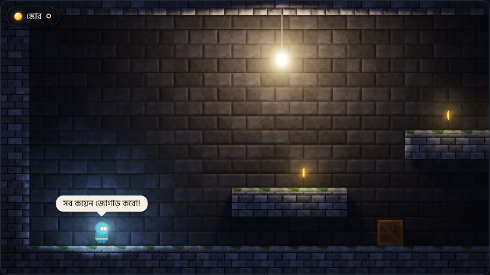
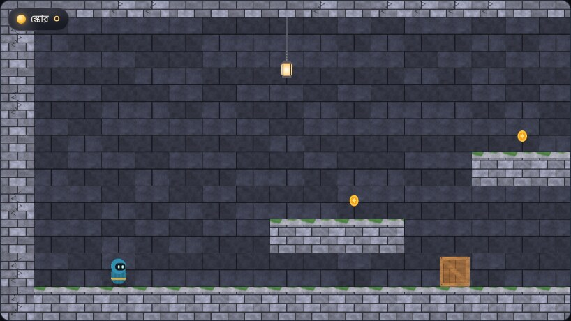
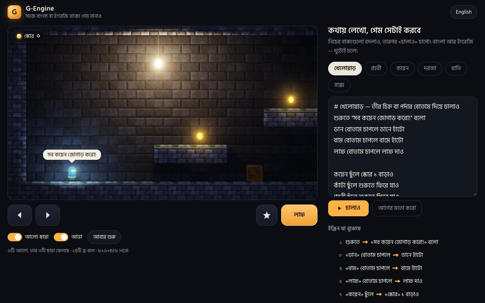
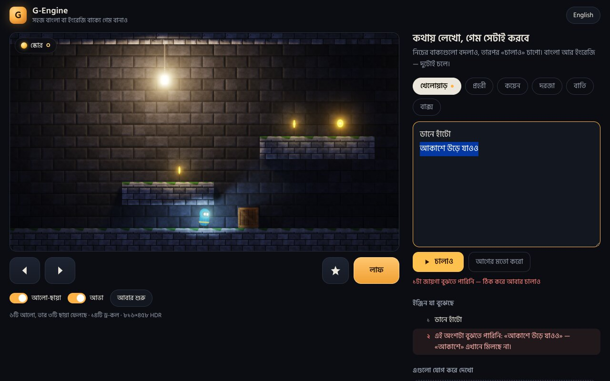
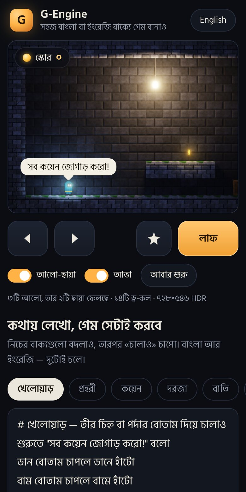
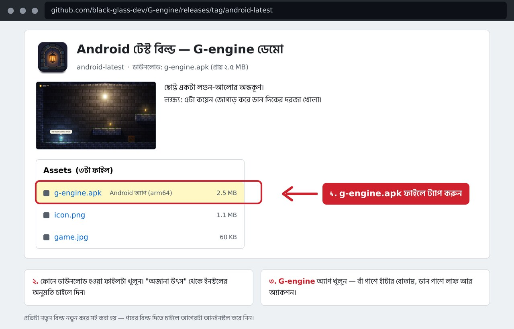

# G-Engine

**মোবাইলের জন্য 2D গেম ইঞ্জিন — গেমের সব আচরণ লেখা হয় সহজ বাংলা বা ইংরেজি বাক্যে, কোড ছাড়া।**

*A 2D game engine for mobile: everything a game does is written in plain Bengali or English sentences, without code. — [English below](#english)*

| আলো-ছায়া চালু · lighting on | একই দৃশ্য, আলো-ছায়া বন্ধ · same scene, lighting off |
|:---:|:---:|
|  |  |

> **অবস্থা:** একেবারে শুরুর দিক — [রোডম্যাপের](ROADMAP.md) ধাপ ১ (প্রথম চলন্ত নমুনা)। এখন ব্রাউজারে চলে।
> Android অ্যাপ (APK)-এর টেস্ট বিল্ড [রিলিজে](https://github.com/black-glass-dev/G-engine/releases/tag/android-latest) রাখা আছে; কোনো আসল ফোনে চালিয়ে দেখা এখনো হয়নি।

---

## কী আছে

- **কথা (Kotha) — বাক্যে গেম বানানো।** `কয়েন ছুঁলে স্কোর ১ বাড়াও` আর `when touching a coin, increase score by 1` — দুটো একই কথা; বাংলা-ইংরেজি এক স্ক্রিপ্টে মেশানোও যায়। ইঞ্জিন প্রতিটা লাইন **কীভাবে বুঝল** তা পাশে লিখে দেখায়। না বুঝলে লাইন ধরে বলে কোন শব্দে আটকেছে, বানান ভুল হলে কাছাকাছি শব্দটা দেখায়। → [ভাষার নির্দেশিকা](docs/KOTHA.md)
- **আলো-ছায়া।** প্রতিটা ছবির সাথে normal map, চলন্ত রঙিন আলো, নরম ছায়া, HDR, bloom — পুরো দৃশ্য ১৪টা draw call-এ (OpenGL ES 3.0 / WebGL 2)। → [রেন্ডারিং কীভাবে কাজ করে](docs/RENDERING.md)
- **পদার্থবিদ্যা।** [Box2D](https://box2d.org) v3.2 — হাঁটা, লাফ, ঠেলে বাক্স সরানো।
- **ওয়েব প্লেয়ার ও এডিটর।** ফোনের ব্রাউজারে খেলা যায় (পর্দার বোতাম), আর পাশেই স্ক্রিপ্ট বদলে «চালাও» চাপলে সাথে সাথে ফল দেখা যায়। ইন্টারফেস বাংলা ও ইংরেজিতে।
- **নমুনা গেম।** বাতির আলোয় একটা ছোট অন্ধকূপ — কয়েন, কাঁটা, প্রহরী, দরজা। সবার আচরণ কথা-য় লেখা ([`games/demo/demo.cpp`](games/demo/demo.cpp))।



| ভুল লিখলে লাইন ধরে বলে দেয় · a mistake is pointed out, line by line | ফোনের মাপের পর্দা (অনুকরণ) · a phone-sized screen (emulated) |
|:---:|:---:|
|  |  |

## চালিয়ে দেখুন

লাগবে Python 3 (pip সহ)। পরীক্ষা চালাতে একটা C++20 কম্পাইলারও লাগবে (g++ 11+ বা clang 14+)। এ পর্যন্ত শুধু Linux-এ চালানো হয়েছে।

```sh
sh tools/setup.sh         # একবার: CMake, Ninja আর Zig (WebAssembly কম্পাইলার) বসায়
sh tools/build_web.sh     # ইঞ্জিন বানায় → web/g-engine.wasm
python3 tools/serve.py    # ঠিকানা দেখাবে: http://localhost:8080
```

- **ফোনে:** ফোন একই Wi-Fi-তে থাকলে `serve.py` যে দ্বিতীয় ঠিকানাটা দেখায় সেটা ফোনের ব্রাউজারে খুলুন।
- **খেলা:** ← → হাঁটা, Space লাফ, E অ্যাকশন; ফোনে পর্দার বোতাম।
- `web/g-engine.wasm` একটা build-ফল, তাই git-এ রাখা হয়নি। build-এর পর `web/` ফোল্ডারটা যেকোনো static হোস্টে তুলে দিলেই চলে।

## Android APK (টেস্ট বিল্ড)

[](https://github.com/black-glass-dev/G-engine/releases/tag/android-latest)

**ডাউনলোড: [`g-engine.apk`](https://github.com/black-glass-dev/G-engine/releases/download/android-latest/g-engine.apk)** — [রিলিজ পেজ](https://github.com/black-glass-dev/G-engine/releases/tag/android-latest)। GitHub Actions প্রতিটা push-এ টেস্ট চালিয়ে নতুন APK বানায় ওই রিলিজে জমা দেয়।

1. উপরের ছবির মতো **Assets** থেকে `g-engine.apk` নামান।
2. ফোনে ফাইলটা খুলে ইনস্টল করুন ("অজানা উৎস" এর অনুমতি চাইলে দিন)।
3. **G-engine** চালু করুন — বাঁ পাশে হাঁটা, ডান পাশে লাফ ও অ্যাকশন (ল্যান্ডস্কেপে চলবে)।

সীমা: শুধু arm64-v8a ফোন (Android 7+); প্রতিটা বিল্ড নতুন করে সই করা — নতুনটা দিতে চাইলে আগেরটা আনইনস্টল করুন; আইকন আপাতত। ফোনে কতটা মসৃণ চলে সেটা এখনো মাপা হয়নি — জানালে কাজে লাগবে।

## প্রথম কয়েকটা বাক্য

এডিটরে «প্রহরী» ট্যাবে গিয়ে এটা লিখে «চালাও» চাপুন:

```kotha
# প্রহরী — পাহারা দেয়, কাছে এলে সাবধান করে
বারবার:
    বামে ৩ মিটার যাও
    ডানে ৩ মিটার যাও
খেলোয়াড় কাছে এলে "থামো!" বলো
```

একই রকম জিনিস ইংরেজিতে, খেলোয়াড়ের জন্য:

```kotha
# player
when the right button is pressed, walk right
when the left button is pressed, walk left
when the jump button is pressed, jump
when touching a coin, increase score by 1
when score is 5, win the game
```

সব কাজ, শর্ত আর নিয়ম: [docs/KOTHA.md](docs/KOTHA.md)।

## পরীক্ষা

```sh
sh tools/test.sh            # ইঞ্জিনের পরীক্ষা (পর্দা বা গ্রাফিক্স কার্ড লাগে না)
sh tools/test.sh --asan     # একই, মেমরি-ভুল ও undefined behaviour ধরার ব্যবস্থাসহ
sh tools/test.sh --web      # + ওয়েব build ও আসল (headless) ব্রাউজারে পরীক্ষা
                            #   (একবার: sh tools/setup.sh --browser-test — Node.js 18+ লাগে, একটা Chromium নামায়)
```

এখন যা আছে:

- **ইঞ্জিন:** ৫১টা পরীক্ষা, ৬৮৩০টা যাচাই — ভাষা (বাংলা ও ইংরেজি বাক্য, ভুল ধরা), পদার্থবিদ্যা, খেলার নিয়ম। এর মধ্যে একটা রোবট নমুনা গেমটা শুরু থেকে শেষ পর্যন্ত খেলে জেতে, আর এই README ও [ভাষার নির্দেশিকার](docs/KOTHA.md) প্রতিটা উদাহরণ কম্পাইল হয়।
- **ব্রাউজার:** ২৪টা যাচাই — WebGL ভুল নেই, কিবোর্ড ও পর্দার বোতাম, স্ক্রিপ্ট বদলানো, ভুল স্ক্রিপ্ট ফিরিয়ে দেওয়া, ৪০টা বাতির দৃশ্য, ফোনের মাপের পর্দা।

**যা যাচাই করা যায়নি:** আসল ফোন বা আসল গ্রাফিক্স চিপে গতি (fps)। ব্রাউজারের পরীক্ষা চলে headless Chromium-এ, সফটওয়্যার রেন্ডারিং আর ফোনের অনুকরণে — সেটা বলে ছবি ঠিক আসছে, কিন্তু ফোনে কত দ্রুত চলবে তা বলে না।

## ফোল্ডার

| কোথায় | কী |
|---|---|
| `engine/script/` | কথা ভাষা: শব্দভাণ্ডার, কম্পাইলার, চালক (VM) |
| `engine/gfx/` | রেন্ডারার, শেডার, কোড দিয়ে আঁকা নমুনা ছবি |
| `engine/physics/` | Box2D-র উপরে পাতলা স্তর |
| `engine/scene/`, `engine/app/` | খেলার জগৎ: জিনিস, লেভেল, নিয়ম চালানো |
| `engine/platform/web/` | ব্রাউজারের (WebAssembly) প্রবেশপথ |
| `games/demo/` | নমুনা গেম: লেভেলের ছবি ও স্ক্রিপ্ট |
| `web/` | ওয়েব প্লেয়ার ও এডিটর (HTML, CSS, JS) |
| `tests/`, `tools/` | পরীক্ষা; build, সার্ভার ও পরীক্ষার স্ক্রিপ্ট |
| `third_party/box2d/` | Box2D v3.2.0 (অপরিবর্তিত) |

লেভেল এখন অক্ষরে আঁকা একটা ছবি (`#` দেয়াল, `P` খেলোয়াড়, `G` প্রহরী, `c` কয়েন, `^` কাঁটা, `B` বাক্স, `D` দরজা, `L` বাতি)। ব্রাউজারের console-এ `ge.level()` দিয়ে দেখা আর `ge.setLevel(ছবি)` দিয়ে বদলানো যায়।

## এখনো যা নেই

Android অ্যাপ · শব্দ ও সংগীত · নিজের ছবি আনা (এখন সব ছবি কোড দিয়ে আঁকা) · লেভেল আঁকার এডিটর · কাজ সংরক্ষণ (পাতা আবার খুললে এডিটরে বদলানো স্ক্রিপ্ট হারিয়ে যায়) · একাধিক লেভেল। কোনটা কখন, তা [রোডম্যাপে](ROADMAP.md)।

## লাইসেন্স

প্রকল্পের নিজের লাইসেন্স এখনো ঠিক করা হয়নি ([রোডম্যাপ, অংশ ৬](ROADMAP.md))। সাথে থাকা অন্যদের কাজ: Box2D — MIT ([`third_party/box2d/LICENSE`](third_party/box2d/LICENSE)); Hind Siliguri ফন্ট — SIL Open Font License ([`web/fonts/LICENSE-HindSiliguri.txt`](web/fonts/LICENSE-HindSiliguri.txt))।

---

<a id="english"></a>

# English

> **Status:** very early — phase 1 of the [roadmap](ROADMAP.md) (the first playable slice). It runs in the browser today.
> A test build of the Android app (APK) sits in the [releases](https://github.com/black-glass-dev/G-engine/releases/tag/android-latest); nothing has been run on a real phone so far.

## What is here

- **Kotha (কথা, "speech") — games made of sentences.** `when touching a coin, increase score by 1` and `কয়েন ছুঁলে স্কোর ১ বাড়াও` mean the same thing, and both languages can be mixed in one script. Next to every line the engine shows **how it understood it**. When it does not understand, it names the line and the word it got stuck on, and suggests the nearest word for a typo. → [Language guide](docs/KOTHA.md)
- **Lighting.** A normal map for every sprite, moving coloured lights, soft shadows, HDR and bloom — the whole scene in 14 draw calls (OpenGL ES 3.0 / WebGL 2). → [How rendering works](docs/RENDERING.md)
- **Physics.** [Box2D](https://box2d.org) v3.2 — walking, jumping, pushing crates.
- **Web player and editor.** Playable in a phone browser (on-screen buttons); change a script next to the game, press "Run", and see the result at once. The interface is in Bengali and English.
- **Sample game.** A small lamp-lit dungeon with coins, spikes, a guard and a door. Everything they do is written in Kotha ([`games/demo/demo.cpp`](games/demo/demo.cpp)).

## Try it

You need Python 3 with pip; for the tests also a C++20 compiler (g++ 11+ or clang 14+). So far this has only been run on Linux.

```sh
sh tools/setup.sh         # once: installs CMake, Ninja and Zig (the WebAssembly compiler)
sh tools/build_web.sh     # builds the engine → web/g-engine.wasm
python3 tools/serve.py    # prints the address: http://localhost:8080
```

- **On a phone:** with the phone on the same Wi-Fi, open the second address that `serve.py` prints.
- **Playing:** ← → walk, Space jump, E action; on a phone, the on-screen buttons.
- `web/g-engine.wasm` is a build product and therefore not in git. After building, the `web/` folder can be copied to any static host.

## Android APK (test build)

[](https://github.com/black-glass-dev/G-engine/releases/tag/android-latest)

**Download: [`g-engine.apk`](https://github.com/black-glass-dev/G-engine/releases/download/android-latest/g-engine.apk)** — [release page](https://github.com/black-glass-dev/G-engine/releases/tag/android-latest). GitHub Actions runs the tests and publishes a fresh APK to that release on every push.

1. As in the picture above, download `g-engine.apk` from **Assets**.
2. Open the file on the phone and install it (allow "unknown sources" if asked).
3. Start **G-engine** — walk with the left side, jump and action on the right (it runs in landscape).

Limits: arm64-v8a phones only (Android 7+); every build is freshly signed, so uninstall the old one before installing a newer build; the icon is temporary. How smoothly it runs on a phone is still unmeasured — telling me helps.

## First sentences

Open the "Guard" tab in the editor, type this and press "Run":

```kotha
# guard: patrols, and warns when you come close
forever:
    go left 3 meters
    go right 3 meters
when the player is near, say "stop!"
```

Every action, condition and rule: [docs/KOTHA.md](docs/KOTHA.md).

## Tests

```sh
sh tools/test.sh            # engine tests (no screen or graphics card needed)
sh tools/test.sh --asan     # the same with memory-error and undefined-behaviour checking
sh tools/test.sh --web      # + the web build and a test in a real (headless) browser
                            #   (once: sh tools/setup.sh --browser-test — needs Node.js 18+, downloads a Chromium)
```

What exists now:

- **Engine:** 51 tests, 6830 checks — the language (Bengali and English sentences, error reporting), physics, game rules. One of them is a robot that plays the sample game from start to finish and wins; another compiles every example in this README and in the [language guide](docs/KOTHA.md).
- **Browser:** 24 checks — no WebGL errors, keyboard and on-screen buttons, changing a script, refusing a broken script, a scene with 40 lamps, a phone-sized screen.

**What could not be verified:** speed (fps) on a real phone or a real graphics chip. The browser test runs in headless Chromium with software rendering and phone emulation. That shows the picture is right; it does not show how fast a phone will draw it.

## Layout

| Where | What |
|---|---|
| `engine/script/` | the Kotha language: vocabulary, compiler, virtual machine |
| `engine/gfx/` | renderer, shaders, the sample art (painted by code) |
| `engine/physics/` | a thin layer over Box2D |
| `engine/scene/`, `engine/app/` | the game world: things, the level, running the rules |
| `engine/platform/web/` | the browser (WebAssembly) entry point |
| `games/demo/` | the sample game: level picture and scripts |
| `web/` | web player and editor (HTML, CSS, JS) |
| `tests/`, `tools/` | tests; build, server and test scripts |
| `third_party/box2d/` | Box2D v3.2.0 (unmodified) |

For now a level is a picture made of characters (`#` wall, `P` player, `G` guard, `c` coin, `^` spikes, `B` crate, `D` door, `L` lamp). In the browser console, `ge.level()` shows it and `ge.setLevel(picture)` replaces it.

## Not there yet

An Android app · sound and music · importing your own pictures (all art is painted by code for now) · a level editor · saving your work (scripts changed in the editor are lost when the page is reloaded) · more than one level. What comes when is in the [roadmap](ROADMAP.md).

## Licence

The project's own licence has not been chosen yet ([roadmap, section 6](ROADMAP.md)). Third-party work included here: Box2D — MIT ([`third_party/box2d/LICENSE`](third_party/box2d/LICENSE)); the Hind Siliguri font — SIL Open Font License ([`web/fonts/LICENSE-HindSiliguri.txt`](web/fonts/LICENSE-HindSiliguri.txt)).
