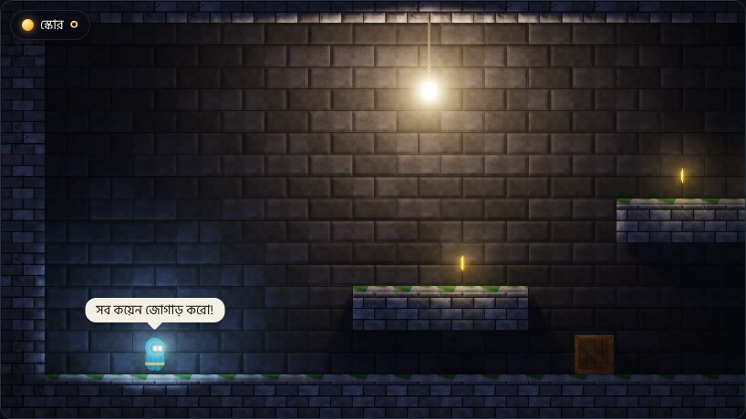
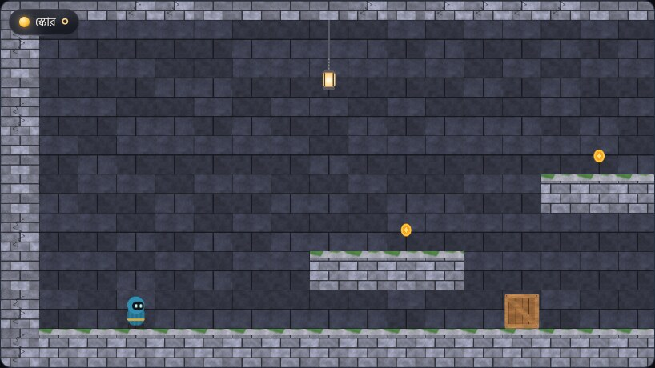
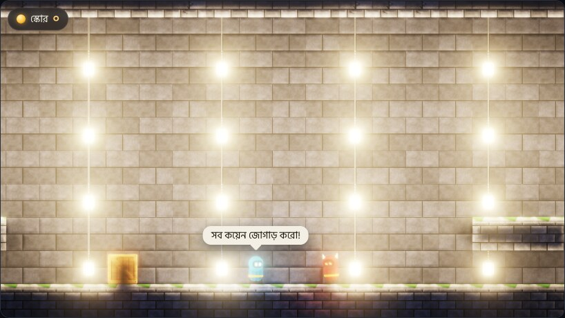

# রেন্ডারিং / Rendering

> **সংক্ষেপে (বাংলা).** প্রতিটা ছবির (sprite) সাথে একটা *normal map* থাকে — ছবির কোন অংশ কোন দিকে মুখ করে আছে তার মানচিত্র। তাই চ্যাপ্টা 2D ছবিতেও আলো পড়লে ইট, কাঠ, পাথরের উঁচু-নিচু ফুটে ওঠে। আলো চলতে পারে, রং বদলাতে পারে, আর দেয়াল, বাক্স ও চরিত্রের নরম ছায়া পড়ে। এরপর HDR, bloom (উজ্জ্বল জিনিসের চারপাশে আভা) আর tone mapping। পুরো ছবিটা আঁকতে ১৪টা draw call লাগে — দৃশ্যে ছবি বা আলো বাড়লেও এই সংখ্যা বাড়ে না। একসাথে ৩২টা আলো ছায়া ফেলতে পারে।
> **যাচাই:** ছবি ঠিক আসছে কি না তা headless Chromium-এ (সফটওয়্যার WebGL 2) পরীক্ষা করা; এই পাতার ছবিগুলো সেখান থেকেই নেওয়া। **আসল ফোনে কত দ্রুত চলে তা এখনো মাপা হয়নি।**
> বাকি অংশ ইংরেজিতে, কারণ এটা ইঞ্জিনের ভেতরের কারিগরি বিবরণ।

| Lighting on | Lighting off (the same sprites) |
|:---:|:---:|
|  |  |

Code: [`engine/gfx/renderer.cpp`](../engine/gfx/renderer.cpp), shaders in [`engine/gfx/shaders.h`](../engine/gfx/shaders.h). Needs OpenGL ES 3.0 or WebGL 2.

## What goes in

Each frame the game hands the renderer three lists ([`RenderFrame`](../engine/gfx/renderer.h)):

- **sprites** — position, size, rotation, a region of the texture atlas, tint, layer;
- **lights** — position, colour × intensity, radius, *height* in front of the picture (low = grazing light, strong relief), and the *size* of the lamp itself (bigger = softer shadow edges);
- **occluders** — straight line segments that block light: the merged outline of the walls and the bounding boxes of crates, doors and characters.

The atlas is two textures of the same layout: colour, and a normal map whose blue channel is an *emissive mask* (parts that glow by themselves: a lamp's flame, a coin).

## How a frame is drawn

| # | Step | What happens | Draw calls |
|---|---|---|---|
| 1 | G-buffer | All sprites, sorted by layer, are drawn in one instanced call into two textures: colour, and normal + emissive. | 1 |
| 2 | Shadow map | Every shadow-casting light gets one row of a 1024 × 32 depth texture. A texel of that row holds the distance from the light to the nearest occluder in one direction (1024 directions around the light). Each (light, edge) pair is one instance; the depth test keeps the nearest. | 1 |
| 3 | Lights | Every light on screen is one instanced quad, added into a light buffer. Per pixel: the angle between the normal from step 1 and the direction to the light, distance fall-off, and the shadow looked up in the light's row, with a soft edge that widens with the lamp's size. | 1 |
| 4 | Composite | colour × (ambient + light) + emissive + haze (light scattered by the air, which is what makes a lamp glow in the dark), in HDR. | 1 |
| 5 | Bloom | Bright parts are blurred through five ever smaller copies and added back. | 9 |
| 6 | Output | ACES tone mapping, vignette, and dithering against banding in the dark gradients. | 1 |

That is 14 draw calls, and the number does not grow with the scene. The sample level (187 sprites, 6 lights, 3 of them casting shadows) takes 14; a test level with 40 lamps (245 sprites, 38 lights on screen, 32 casting shadows, 490 shadow edges) also takes 14.

*The test level with 40 lamps.*

Details worth knowing:

- **Which lights cast shadows.** At most 32 at a time (`Renderer::kShadowRows`). When more are on screen, the ones nearest to the centre of the view get the rows; the others still shine, without shadows.
- **Light enters solid things a little** (`penetration`, 0.45 m by default). Without it the lit face of a wall would be black, since the wall is its own occluder.
- **A carried light ignores its carrier.** The player's glow is not blocked by the player's own outline (`LightDraw::owner`).
- **Render targets.** Light and scene buffers are 16-bit float (RGBA16F) when the device can render to them, otherwise 8-bit. Only the 16-bit path has been seen running; the 8-bit fallback is untested.

## Settings

[`RenderSettings`](../engine/gfx/renderer.h):

| Setting | Default | Meaning |
|---|---|---|
| `lighting` | on | off = flat picture, steps 2 and 3 are skipped |
| `bloom` | on | off = step 5 is skipped |
| `lightScale` | 1.0 | resolution of the light buffer relative to the screen; 0.5 means a quarter of the pixels to light |
| `exposure` | 1.0 | overall brightness before tone mapping |
| `haze` | 0.03 | how much light the air scatters |
| `bloomStrength` | 0.55 | how strong the glow is |
| `penetration` | 0.45 | how deep (m) light reaches into solid things |

The web player ([`web/app.js`](../web/app.js)) picks from five quality levels. Touch devices start at level 1, others at level 0; `?quality=N` in the address fixes the level.

| Level | Pixel ratio (at most) | Light buffer |
|---|---|---|
| 0 | 2 | 1.0 |
| 1 | 2 | 0.5 |
| 2 | 1.5 | 0.5 |
| 3 | 1 | 0.5 |
| 4 | 0.75 | 0.35 |

When the frame rate stays under 40 for two seconds, the page moves one level down. This is written but **has not been observed on a real device**; the thresholds are a first guess.

## What has been verified, and what has not

- **Verified in a browser** (headless Chromium, software WebGL 2, by `tools/web_test.mjs`): the engine starts and draws without any WebGL error or console warning, the frame figures quoted above, and the 40-lamp level. The pictures on this page were taken there and looked at by eye.
- **Verified without a graphics card** (`tests/test_game.cpp`, against a do-nothing GL backend): the frame logic — which lights get shadow rows, how many draw calls a frame issues. No pixels are checked there.
- **Not verified:** speed on a real phone or any real GPU. The fill-rate cost of the light and bloom passes on mobile chips is the main open risk of this design ([roadmap, risks](../ROADMAP.md)); that is what `lightScale` and the quality levels are for.

## Limits

- Point lights only: no cones, no sun.
- Shadows come from straight edges (walls and bounding boxes), not from the shape of the picture.
- Shadows are neither coloured nor translucent.
- One texture atlas, generated by code at start-up ([`engine/gfx/atlas_gen.cpp`](../engine/gfx/atlas_gen.cpp)). Importing your own pictures with normal maps is roadmap phase 4.
